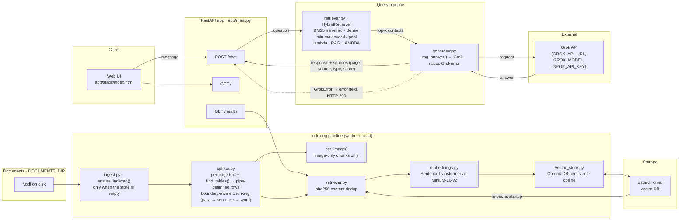

# Architecture

Read-only RAG app over a fixed PDF corpus: startup auto-index → table + text extraction → boundary-aware chunking → hybrid retrieval (BM25 + vector) → Grok generation.

There is no upload endpoint. Documents are the PDFs present in `DOCUMENTS_DIR`.

## Diagram (Mermaid)

## Pipeline

1. **Startup** — `lifespan` calls `ingest.ensure_indexed()`, which is a no-op when the vector store already holds chunks. If the store is empty it discovers every PDF in `DOCUMENTS_DIR` and indexes it, logging loudly; if the directory has no PDFs it warns and starts empty. Runs via `run_in_threadpool`.
2. **Extraction** (`splitter.extract_text_and_images`) — per page: `find_tables()` yields pipe-delimited table chunks (`[Table N | page P]` header repeated in every chunk); `get_text("text")` yields prose, chunked on paragraph → sentence → word boundaries at `CHUNK_SIZE`/`CHUNK_OVERLAP` (default 1000/200) instead of raw character windows. Pages with no text but images emit an image-only chunk.
3. **Indexing** (`retriever.add_documents`) — chunks are hashed (`sha256` over whitespace-normalised text) and skipped if the hash is already known, so re-indexing an already-present document is a no-op. Embedding happens before any in-memory mutation, so a failure cannot desync state. BM25 is rebuilt from the resulting corpus.
4. **Query** (`POST /chat`) — BM25 scores are min-max normalised, and cosine distances from the top `4 × top_k` dense hits are min-max normalised *within the retrieved set* so the best hit scores 1.0 regardless of absolute scale. `combined = λ·dense + (1−λ)·bm25`, `λ = RAG_LAMBDA` (0.5). Exactly `top_k` results are returned (`1 ≤ top_k ≤ 20`).
5. **Generation** (`generator.rag_answer`) — contexts are rendered with page/source/type headers under a `MAX_CONTEXT_CHARS` budget. Every failure mode (missing key, timeout, connection error, HTTP ≥ 400, non-JSON body, empty message) raises `GrokError` with a specific message. `/chat` catches it and returns `used_llm: false` plus a populated `error` field — generation failures are never disguised as answers.
6. **Persistence** — `HybridRetriever` reloads all chunks from Chroma at startup and rebuilds BM25. Writes are guarded by an `RLock`, so concurrent ingests cannot interleave.

## Chunk types

Every chunk carries `meta.type` ∈ `text` | `table` | `image`, surfaced in `/chat` sources and badged in the UI.

## Known limitations

- **OCR is effectively inert.** It only runs for chunks with no text at all, and it requires the `tesseract` binary, which is not installed — `OCR_AVAILABLE` reports `True` (the Python wrapper imports fine) and `ocr_image()` then swallows the error and returns `""`.
- **Charts are invisible.** The forecast PDF contains 2,932 vector drawings but only 1 embedded raster image, so `page.get_images()` cannot see them. Chart data (axis labels, legends) lands in the text stream unstructured.
- **Borderless tables merge columns.** These PDFs' statistical tables have no ruling lines, so `find_tables()` concatenates adjacent columns (e.g. `10 694 0.4 2 188 1.3 6 374`). Row labels and row membership are preserved; individual column boundaries are not.

## Key files

| File | Role |
|------|------|
| `app/main.py` | FastAPI app, chat endpoint, threadpool dispatch |
| `app/ingest.py` | PDF discovery, ingestion, startup auto-indexing |
| `app/splitter.py` | PDF text + table extraction, boundary-aware chunking, OCR |
| `app/embeddings.py` | SentenceTransformer dense embeddings |
| `app/vector_store.py` | ChromaDB persistence, `count()`, `reset()` |
| `app/retriever.py` | Content dedup, hybrid (BM25 + dense) retrieval |
| `app/generator.py` | Grok prompting, `GrokError` |
| `app/static/index.html` | Browser UI |
| `scripts/reingest.py` | Wipe and re-ingest PDFs from scratch |
| `.env` | `GROK_API_KEY`, `GROK_API_URL`, `GROK_MODEL`, optional `RAG_LAMBDA`, `CHUNK_SIZE`, `DOCUMENTS_DIR` |
| `data/chroma/` | Persisted vector DB |